# Основные результаты

RING1 — E3-лигаза комплекса PRC1, которая ставит репрессивную метку H2AK119ub1. Я сравнила связывание RING1 в двух линиях фибробластов:

- **BF** — фибробласты молочной железы взрослой женщины;
- **HS** — неонатальные фибробласты крайней плоти Hs68, мужские.

Главный вывод: RING1 в фибробластах отражает их **позиционное происхождение**. В каждой линии он занимает те гены кластеров HOX и те регуляторы развития, которые соответствуют «чужой» части тела и должны молчать. Граница между генами, связанными в BF и в HS, проходит внутри кластеров HOX и одинакова в обоих повторах.

Ниже: `logFC > 0` — сигнал выше в HS, `logFC < 0` — выше в BF. HS_higher и BF_higher — регионы, значимые по edgeR TREAT (FDR < 0.05, |log2FC| > 1).

## 1. Качество данных и согласованность повторов

| Образец | Прочтений после фильтрации | FRiP (consensus) | Пиков MACS2 по повтору |
|---|---:|---:|---:|
| BF_rep1 | 20.9 млн | 0.50% | 417 |
| BF_rep2 | 14.6 млн | 0.74% | 1619 |
| HS_rep1 | 27.1 млн | 0.70% | 2531 |
| HS_rep2 | 21.1 млн | 0.70% | 1529 |

Сигнал RING1 занимает узкую часть генома, поэтому FRiP низкий у всех образцов. В контролях он ещё в 4–7 раз ниже (0.10–0.14%).

Как согласуются повторы:

- **Подсчёты в общем наборе регионов.** Корреляция Спирмена внутри линии 0.894 (BF) и 0.891 (HS), между линиями 0.43–0.54.
- **PCA.** Первая компонента объясняет 81% дисперсии и разделяет BF и HS. Повторы HS лежат рядом, а повторы BF расходятся по второй компоненте (12%).
- **Совпадение пиков по парам нуклеотидов (Jaccard).** В HS 0.42, в BF 0.077. В BF_rep1 мало пиков, так что BF воспроизводится хуже на уровне коллинга. На уровне подсчётов в общих регионах оба повтора BF ведут себя согласованно.

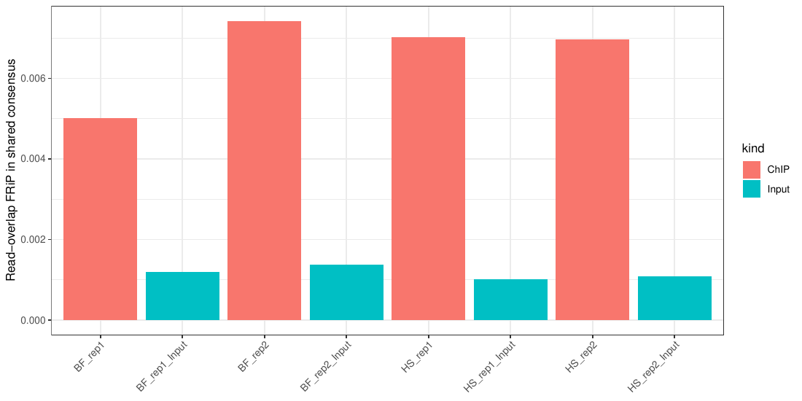
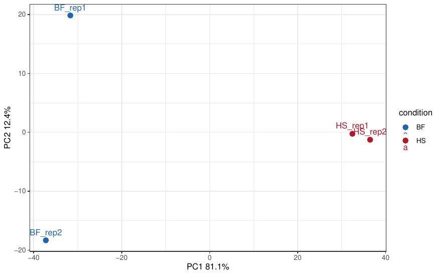
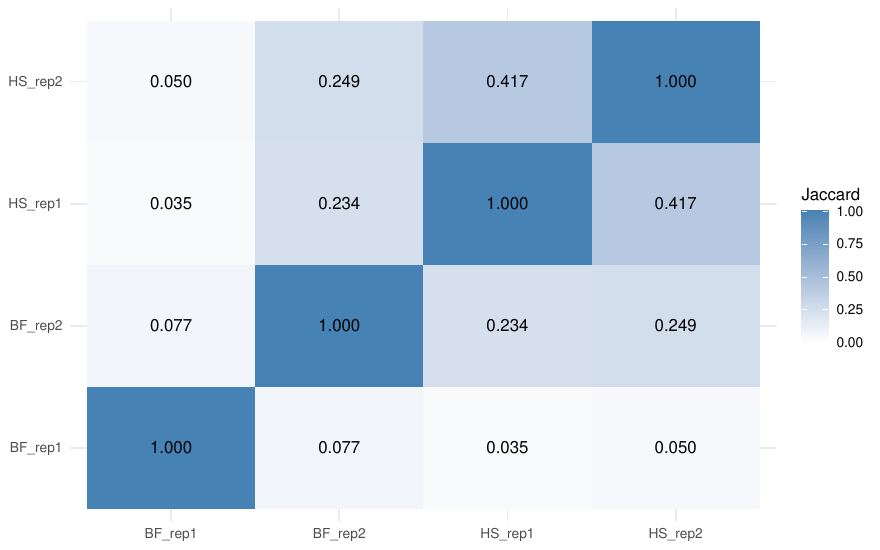

## 2. Дифференциальное связывание BF и HS

- **Общий набор регионов.** Объединение пулированных пиков дало 4209 регионов; 71% из них лежат в промоторах (±3 kb от TSS).
- **Тестирование.** После фильтрации edgeR по экспрессии протестировано 2777 регионов.
- **Значимые различия:**
  - **337 регионов HS_higher**;
  - **246 регионов BF_higher**;
  - остальные 2194 значимо не различаются.

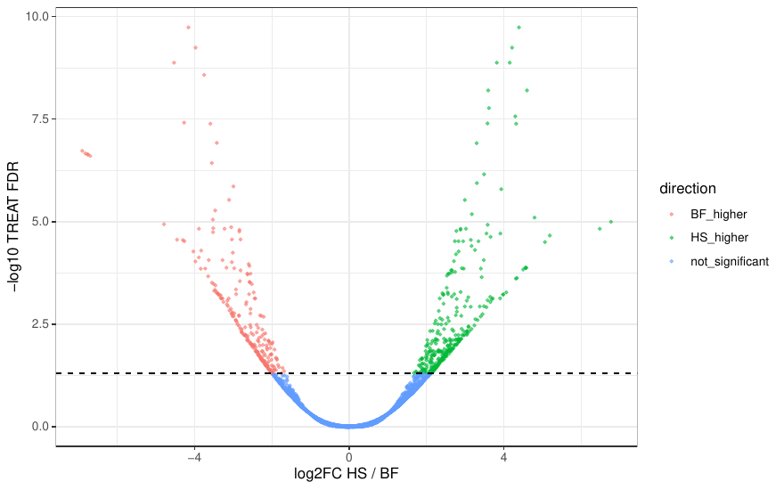
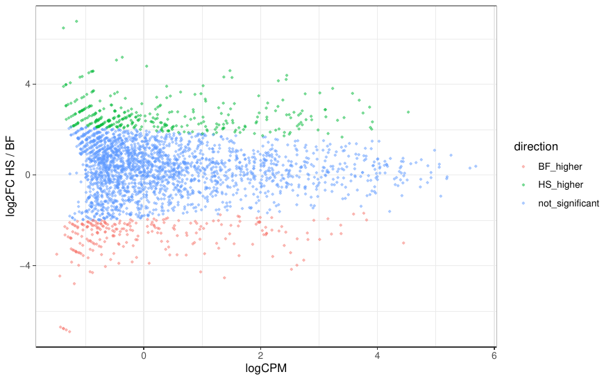

| Направление | Регионов | В промоторах | Дальше 10 kb от TSS | Ведущие гены (по FDR) |
|---|---:|---:|---:|---|
| HS_higher | 337 | 184 (55%) | 92 (27%) | SATB2, HOXA3, HAND1, TBX15, PITX2, HOXB3, HOXC6, HOXB4, HOXD8, NRN1, HOXA2, PAX6, HNF1B |
| BF_higher | 246 | 164 (67%) | 19 (8%) | ISL2, ZIC1, HOXD11, PITX1, HOXD12, GATA2, EVX2, SLITRK3, SIM1, FOXB2, PAX9, NKX2-2, SIX1 |

Обе группы — это в основном гены транскрипционных факторов развития, то есть классические мишени Polycomb. В HS дифференциальные регионы заметно чаще лежат вдали от TSS. Часть из них — широкие домены вокруг генов, которые MACS2 разбивает на несколько пиков (пример — PITX2 ниже).

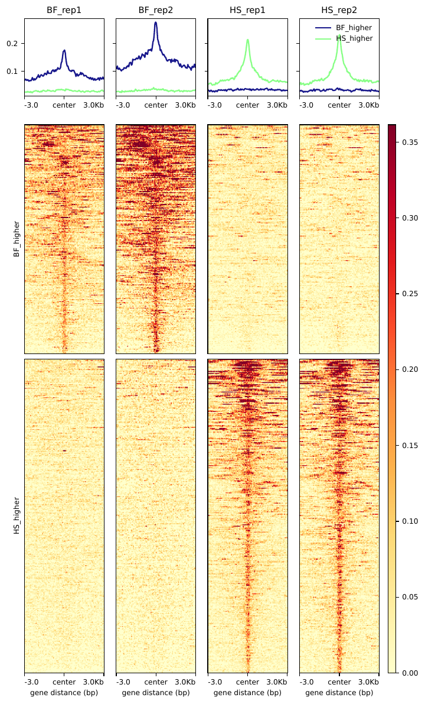

## 3. Позиционный код HOX

Самое наглядное различие — в кластерах HOX.

**Связаны в HS (передние HOX):**

- HOXA2–A7;
- HOXB3/B4;
- HOXC4/C6;
- HOXD3/D8 и соседняя lncRNA HAGLR.

**Связаны в BF (задние HOX):**

- EVX2–HOXD11 (HOXD12, HOXD13);
- HOXB13;
- HOXC10/12 и HOTAIR.

**Задняя половина HOXA (HOXA9–A13)** на уровне контроля в обеих линиях: RING1 её не занимает ни в BF, ни в HS.

**EVX2–HOXD.** Все 16 регионов BF_higher лежат сплошным отрезком от EVX2 до HOXD11 и повторяют домен сигнала в BF. Четыре региона HS_higher начинаются с HOXD8. Между HOXD11 и HOXD9 нет ни одного дифференциального региона: здесь проходит граница между задней частью кластера, занятой в BF, и передней, занятой в HS.

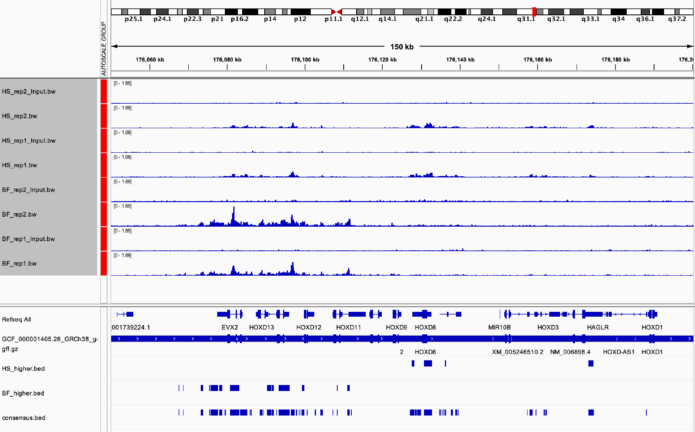

**HOXA.** Все 17 регионов HS_higher сосредоточены от HOXA2 до HOXA7. BF_higher в кластере нет.

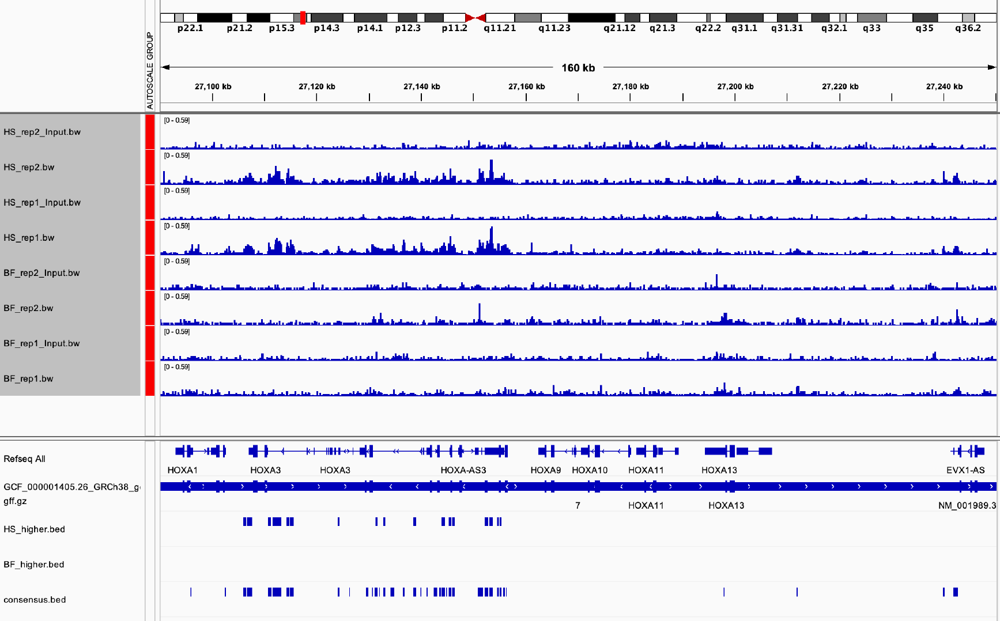

Направление совпадает с происхождением клеток. Крайняя плоть — дистальная и каудальная ткань, поэтому в HS молчат передние HOX и репрессируются Polycomb. В фибробластах молочной железы (туловище) задние HOX не нужны и заняты RING1. Это согласуется с представлением о том, что фибробласты сохраняют HOX-код места своего происхождения.

## 4. Другие регуляторы развития

| Ген | Где связан | Что видно |
|---|---|---|
| PITX1 | BF | 5 из 6 регионов в окне — BF_higher: тело гена, промотор с PITX1-AS1 и соседний EPIST; в HS сигнал на уровне контроля |
| ISL2, GATA2, ZIC1, TBX2-AS1 | BF | регионы BF_higher; в IGV у ISL2 и GATA2 чёткие пики только в BF |
| PITX2 | HS | 13 регионов HS_higher покрывают ген с альтернативными промоторами и соседнюю PANCR — один широкий невысокий домен |
| HAND1, SATB2, TBX15, PAX6 | HS | сильнейшие по FDR регионы HS_higher |
| NRN1, RUNX3 | HS | связаны только в HS; это совпадает с данными Pemberton et al. для Hs68 |

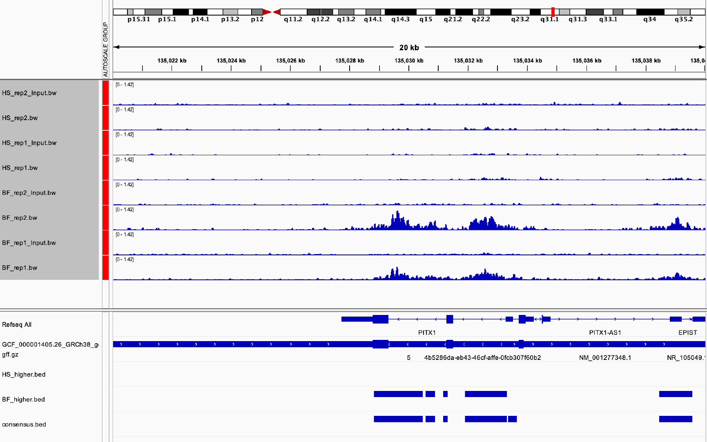
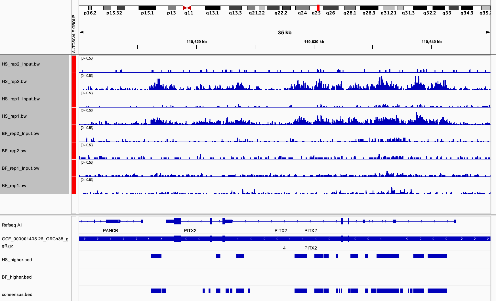

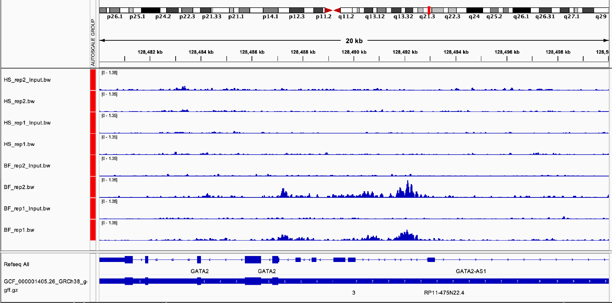
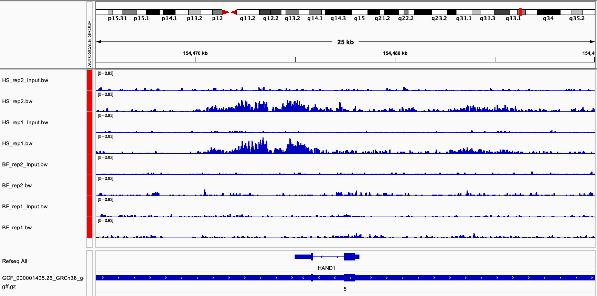

**SRY.** Единственный регион HS_higher на chrY лежит в промоторной области SRY. В BF на chrY нет прочтений ни в ChIP, ни в контроле. Это различие задаётся полом доноров: в женских клетках BF нет хромосомы Y. Поэтому в сравнение тканей этот регион не входит.

**Общие мишени.** OTP и TAL1 связаны в обеих линиях и по edgeR не различаются. Это общие мишени Polycomb, которые молчат в обоих типах фибробластов.

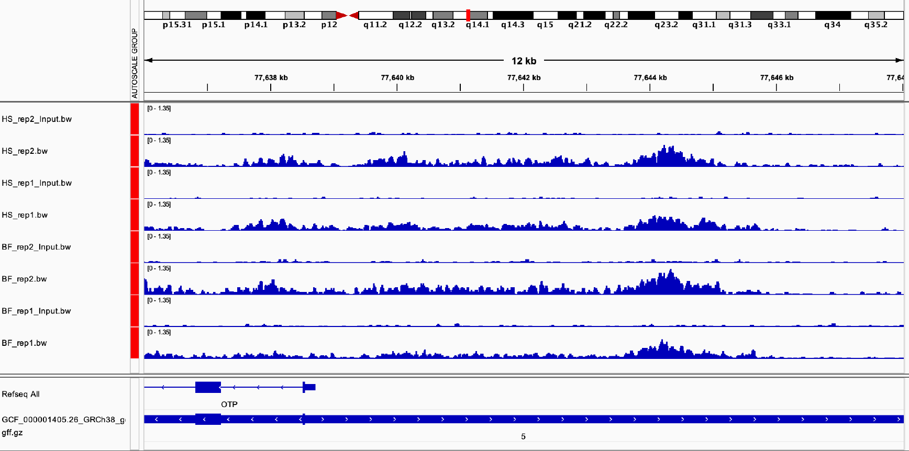
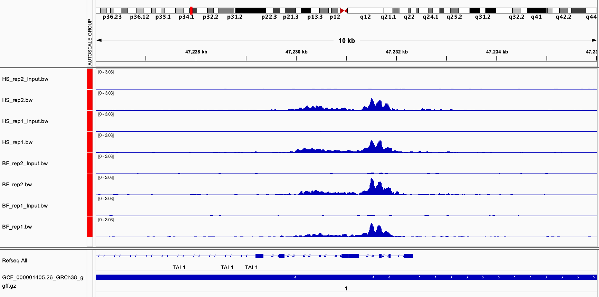

На GAPDH и ACTB (отрицательный контроль) ChIP в обеих линиях на уровне своего контроля.

## 5. bdgdiff по отдельным повторам и аннотация HOMER

| Набор | rep1 | rep2 | Совпадение с edgeR |
|---|---:|---:|---|
| BF_unique | 6 | 273 | в rep2 148 регионов попадают в BF_higher и покрывают 136 из 246 |
| HS_unique | 1085 | 342 | в rep2 161 регион в HS_higher; 76% регионов rep2 есть в rep1 |
| common | 91 | 437 | 96% не различаются по edgeR |

Что показывает аннотация HOMER:

- **HS_unique** в обоих повторах содержит передние HOX (HOXA2–A4, HOXB3/B4, HOXC4/C6, HOXD3/D8), HAND1, PITX2, SATB2, TBX15, PAX6 и NRN1. Самые высокие баллы bdgdiff у SATB2, HOXA3, HAND1, SP9, TBX15 и MIR10A (кластер HOXB), то есть у тех же генов, что лидируют в edgeR.
- **BF_unique** в rep2 содержит задние HOXD, PITX1, ISL2 и GATA2. В rep1 bdgdiff находит всего 6 регионов: в этом повторе мало пиков BF.
- **common** — это регуляторы развития, которые молчат в обоих типах клеток: OTP, TAL1, FOXC1, GATA4, LHX8/9, LBX1, OLIG2/3, TLX2/3, NEUROG2, PAX5, TBR1, VSX2.

Ни один регион HS_unique не пересекается с BF_higher. Значит, bdgdiff по повторам и edgeR указывают одно направление различий.

## 6. Профили сигнала вокруг TSS

В регионах пулированного bdgdiff сигнал RING1 сосредоточен у TSS. В центре окна он примерно в 2.6 раза выше, чем по краям, в HS и примерно в 1.8 раза в BF.

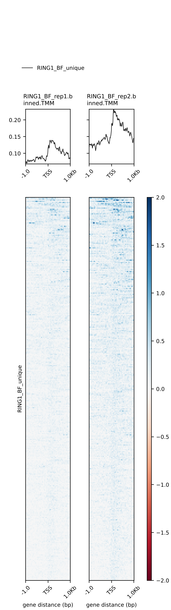
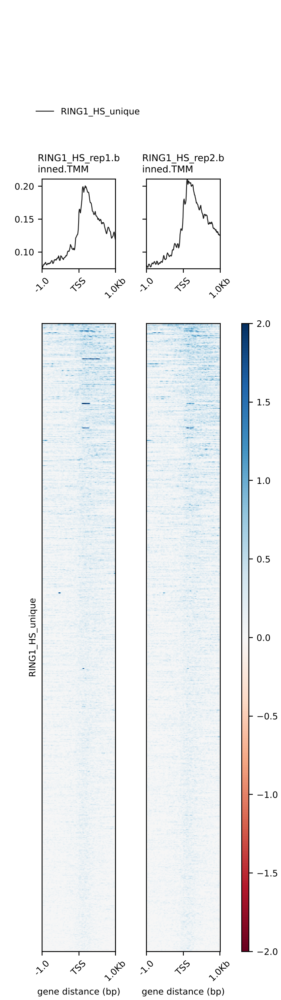

## Вывод

RING1 связывается в основном с промоторами генов транскрипционных факторов развития. Набор этих генов в двух линиях фибробластов различается в соответствии с их анатомическим происхождением:

- в HS RING1 занимает передние HOX, HAND1, PITX2, SATB2 и TBX15;
- в BF — задние HOXD, HOXB13, HOXC10/12, PITX1, ISL2 и GATA2.

Граница внутри кластеров HOX воспроизводится:

- в обоих повторах;
- двумя независимыми методами (edgeR и bdgdiff);
- визуально в IGV.

Таблицы со всеми регионами:

- [`results/tables/differential.annotated.tsv`](results/tables/differential.annotated.tsv);
- [`results/homer/`](results/homer/).
